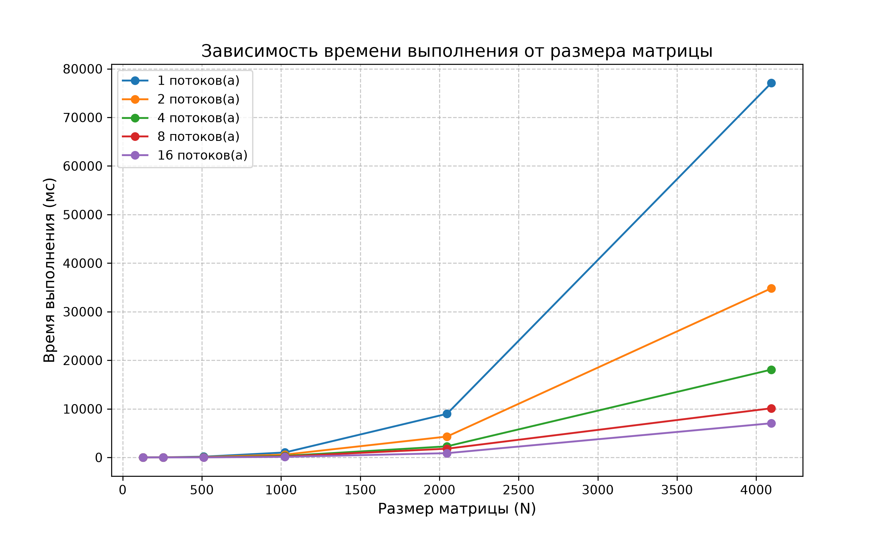
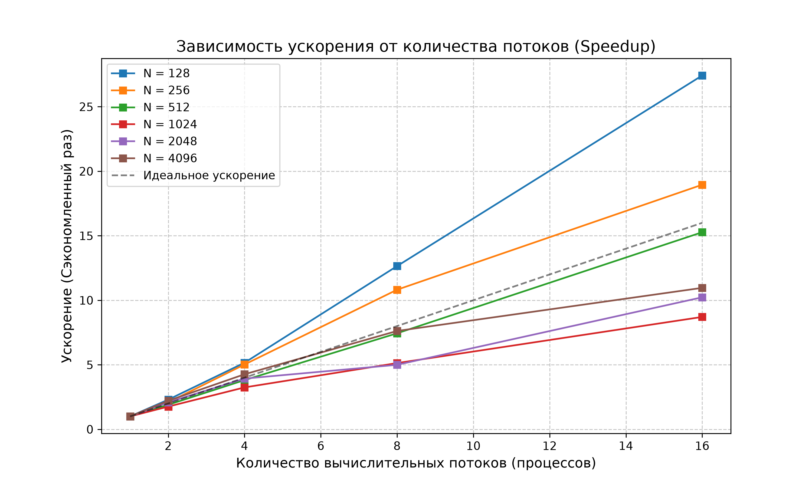

# MPI Matrix Multiplication Benchmark

Реализация и бенчмаркинг параллельного алгоритма умножения квадратных матриц с использованием технологии **MPI (Message Passing Interface)** на суперкомпьютере. Проект включает полную автоматизацию проведения вычислительных экспериментов через менеджер ресурсов **Slurm** и визуализацию результатов производительности (ускорения и времени выполнения) с помощью Python.

---

## 🛠 Технологический стек
* **Язык программирования:** C++ (стандарт C++11 для совместимости с компилятором GCC 4.8.5)
* **Параллельные вычисления:** OpenMPI / MPI
* **Планировщик задач:** Slurm Workload Manager
* **Анализ и визуализация:** Python 3 (`pandas`, `matplotlib`, `numpy`)
##
* **Примечание:** Все необходимые файлы, включая `submit.sh` и `.log` находятся в репозитории данной лабораторной работы.

---

## 📐 Алгоритм и схема параллелизма
В программе реализовано ленточное (1D strip-partitioning) горизонтальное разделение данных:
1. Матрица $A$ делится по строкам между всеми задействованными процессами MPI с помощью функции `MPI_Scatterv`.
2. Матрица $B$ рассылается всем процессам целиком с помощью функции `MPI_Bcast`.
3. Каждый процесс вычисляет свою полосу итоговой матрицы $C$.
4. Результаты собираются на главном процессе (rank 0) с помощью `MPI_Gatherv`.

---

## 🚀 Сборка и запуск

### 1. Компиляция C++ программы
Для компиляции исходного кода с поддержкой стандарта C++11 выполните команду:
```bash
module load intel/mpi5
mpicxx -std=c++11 -O3 matrix_multiply.cpp -o matrix_multiply
```

### 2. Запуск бенчмарка в Slurm
Пакетный запуск серии тестов для различных размеров матриц ($N = 128, 256, 512, 1024, 2048, 4096$) и количества процессов ($1, 2, 4, 8, 16$) выполняется командой:
```bash
sbatch submit.sh
```

---

## 📊 Результаты бенчмаркинга и анализ производительности

### 1. Зависимость времени выполнения от размера матрицы


* **Характер роста сложности:** График демонстрирует кубическую зависимость времени выполнения от размера матрицы ($O(N^3)$), что полностью соответствует теоретической вычислительной сложности классического алгоритма умножения матриц. 
* **Эффект распараллеливания:** Увеличение количества вычислительных процессов (от 1 до 16) существенно снижает общее время расчетов для крупных матриц. Для максимального протестированного размера $N = 4096$ время выполнения сокращается с почти 80 000 мс (на 1 процессе) до менее чем 10 000 мс (на 16 процессах).

---

### 2. Зависимость ускорения от количества процессов (Speedup)


* **Масштабируемость:** Наблюдается стабильный рост ускорения с увеличением числа процессов для всех размеров задач.
* **Влияние накладных расходов (overhead):** Для малых размеров матриц ($N = 128, 256$) на итоговые метрики оказывают сильное влияние накладные расходы на инициализацию MPI, синхронизацию и межпроцессное взаимодействие по сети.
* **Поведение на крупных задачах ($N = 2048, 4096$):** Для наиболее трудоемких задач кривые ускорения демонстрируют устойчивую и эффективную масштабируемость. На 16 процессах для матрицы $N = 4096$ достигается ускорение более чем в 10–11 раз по сравнению с последовательным выполнением.

---

## 📝 Заключение
Разработанная MPI-программа демонстрирует высокую производительность и эффективную масштабируемость на вычислительном кластере. Полученные результаты подтверждают целесообразность применения параллельных вычислений для ресурсоемких задач линейной алгебры.
