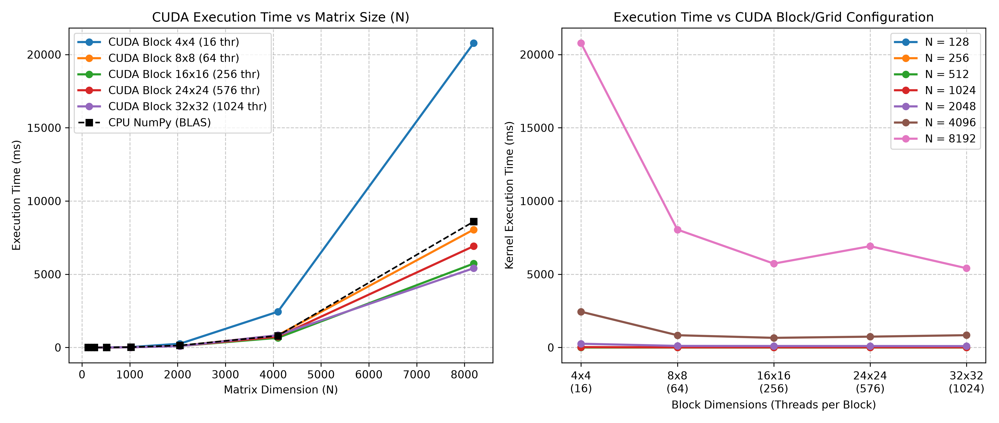
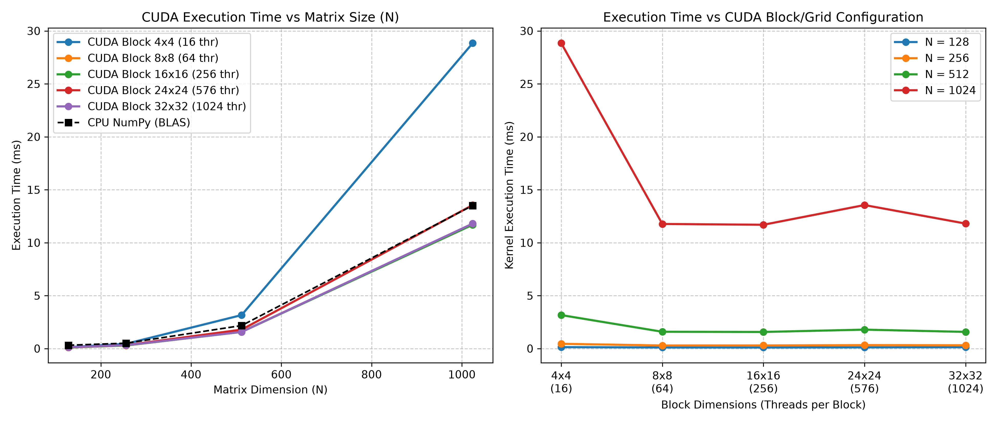
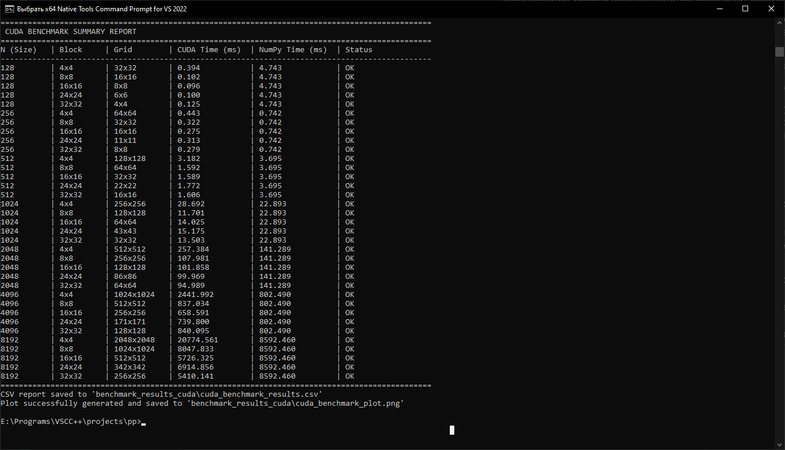

# CUDA Matrix Multiplication Benchmark (NVIDIA GeForce GTX 1070)

Реализация и автоматизированный бенчмаркинг параллельного умножения квадратных матриц с двойной точностью (`double`) на графическом процессоре с использованием технологии **NVIDIA CUDA**. Проект включает кастомное CUDA-ядро, автоматическую сборку и оркестрацию тестов на Python, верификацию результатов через `NumPy` (BLAS), экспорт метрик в CSV и построение графиков производительности.

## ⚙️ Аппаратное окружение и выбор версии CUDA 12.6

* **Графический процессор (GPU):** NVIDIA GeForce GTX 1070 (8 ГБ GDDR5, архитектура **Pascal**, Compute Capability `sm_61`).
* **Инструментарий и компилятор:** **NVIDIA CUDA Toolkit 12.6** (`nvcc` + хост-компилятор MSVC / Visual Studio 2022, стандарт C++17).

### Почему используется именно CUDA 12.6?

Видеокарта **GeForce GTX 1070** построена на архитектуре **Pascal (`sm_61`)**, которая относится к предыдущим поколениям GPU NVIDIA. В более новых версиях инструментария (начиная с **CUDA 13.0**) поддержка архитектур Maxwell, Pascal и Volta (`sm_50`–`sm_72`) была официально прекращена, что приводит к ошибке компиляции `nvcc fatal : Unsupported gpu architecture 'sm_61'`. Использование **CUDA Toolkit 12.6** обеспечивает полную аппаратную совместимость с архитектурой `sm_61` и позволяет корректно компилировать и запускать CUDA-ядра на GTX 1070.

## 🚀 Особенности реализации проекта

1. **Гибкая конфигурация сетки и блоков (`matrix_multiply.cu`):**
   * Каждый поток CUDA вычисляет один элемент результирующей матрицы `C[row][col]`.
   * Программа принимает размер стороны двумерного блока (`block_size` от `1` до `32`, т.е. от `1` до `1024` потоков на блок) через аргументы командной строки.
   * Размерность сетки блоков (`dim3 numBlocks`) вычисляется автоматически: `ceil(N / block_size) × ceil(N / block_size)`.

2. **Точный замер времени на GPU:**
   * Чистое время выполнения вычислительного ядра (`Kernel Execution Time`) измеряется с помощью аппаратных событий **`cudaEventRecord`**, исключая накладные расходы на дисковый ввод-вывод.

3. **Автоматизация и верификация (`run_benchmark_cuda.py`):**
   * Автоматическая компиляция `.cu`-кода с флагами `-std=c++17 -O3 -arch=sm_61`.
   * Генерация тестовых матриц различных размерностей (`N` из набора `128, 256, 512, 1024, 2048, 4096, 8192`) и прогон для различных конфигураций блоков (`4×4`, `8×8`, `16×16`, `24×24`, `32×32`).
   * Проверка корректности каждого прогона с помощью `np.allclose` относительно эталонного умножения `NumPy` (`OK` для всех конфигураций).
   * Сохранение детального отчета в `cuda_benchmark_results.csv` и визуализация графиков.

## 🛠️ Сборка и запуск

### 1. Автоматический запуск бенчмарка

Откройте консоль с настроенным окружением MSVC (например, *x64 Native Tools Command Prompt for VS 2022*) в папке проекта и выполните:

```bash
python run_benchmark_cuda.py
```

Скрипт скомпилирует программу, запросит желаемые размеры матриц и размеры блоков, проведет серию экспериментов и сохранит результаты в папку `benchmark_results_cuda/`.

### 2. Ручная компиляция и одиночный запуск

```bash
nvcc -std=c++17 -O3 -arch=sm_61 matrix_multiply.cu -o matrix_multiply_cuda.exe
matrix_multiply_cuda.exe A.txt B.txt C.txt 16
```

## 📊 Результаты бенчмаркинга

### Сводная таблица (сравнение конфигураций блоков CUDA и CPU NumPy)

| Размер матрицы (`N`) | Блок `4×4` (16 thr) | Блок `8×8` (64 thr) | Блок `16×16` (256 thr) | Блок `24×24` (576 thr) | Блок `32×32` (1024 thr) | CPU NumPy (BLAS) | Статус проверки |
| :--- | :--- | :--- | :--- | :--- | :--- | :--- | :--- |
| **128** | 0.394 мс | 0.102 мс | **0.096 мс** | 0.100 мс | 0.125 мс | 4.743 мс | OK |
| **256** | 0.443 мс | 0.322 мс | **0.275 мс** | 0.313 мс | 0.279 мс | 0.742 мс | OK |
| **512** | 3.182 мс | 1.592 мс | **1.589 мс** | 1.772 мс | 1.606 мс | 3.695 мс | OK |
| **1024** | 28.692 мс | **11.701 мс** | 14.025 мс | 15.175 мс | 13.503 мс | 22.893 мс | OK |
| **2048** | 257.384 мс | 107.981 мс | 101.858 мс | 99.969 мс | **94.989 мс** | 141.289 мс | OK |
| **4096** | 2441.992 мс | 837.034 мс | **658.591 мс** | 739.800 мс | 840.095 мс | 802.490 мс | OK |
| **8192** | 20774.561 мс | 8047.833 мс | 5726.325 мс | 6914.856 мс | **5410.141 мс** | 8592.460 мс | OK |

### Визуализация производительности и вывод консоли

#### Графики зависимости времени выполнения от размера матрицы и конфигурации блоков



чуть более наглядный график для анализа поведения более мелких размеров матриц (до `1024×1024`), на котором видно общую тенденцию у уменьшению времени от роста размера блоков



#### Сводный отчет выполнения в терминале



## 📝 Выводы по результатам экспериментов

1. **Критический провал производительности при мелких блоках (`4×4`):**
   * Блок размером `4×4` содержит всего **16 потоков**, что вдвое меньше размера аппаратного варпа в архитектуре NVIDIA (**32 потока**). В результате половина вычислительных линий каждого варпа простаивает, а огромное число блоков в сетке (например, `2048×2048` блоков для `N = 8192`) создает избыточную нагрузку на планировщик. На матрице `N = 8192` конфигурация `4×4` выполняется **20774.561 мс**, что почти в **3.8 раза медленнее** оптимальных конфигураций и в **2.4 раза медленнее** CPU NumPy.

2. **Оптимальные конфигурации сетки для GTX 1070 (`16×16` и `32×32`):**
   * Наилучшую и наиболее стабильную производительность на крупных задачах показывают блоки `16×16` **(256 потоков)** и `32×32` **(1024 потока)**, размер которых кратен размеру варпа (32) и эффективно загружает потоковые мультипроцессоры (SM) видеокарты.
   * На максимальной матрице `N = 8192` (`1.1 × 10¹²` операций с плавающей точкой) конфигурация `32×32` завершает расчет за **5410.141 мс**, а `16×16` — за **5726.325 мс**. Промежуточный блок `24×24` (576 потоков) на крупных матрицах уступает им по времени (**6914.856 мс** при `N = 8192`) из-за менее выгодного распределения активных блоков на мультипроцессорах (occupancy).

3. **Превосходство GPU над многопоточным CPU (NumPy / BLAS):**
   * Несмотря на то, что использовалось базовое CUDA-ядро с обращением к глобальной памяти (без разделяемой памяти `shared memory`), а `NumPy` задействует высокооптимизированные многопоточные библиотеки BLAS, видеокарта **GTX 1070 уверенно опережает процессор** на средних и крупных матрицах при корректном выборе размера блока:
     * на `N = 1024` — ускорение до **~1.96×** (11.701 мс против 22.893 мс на блоке `8×8`);
     * на `N = 2048` — ускорение до **~1.49×** (94.989 мс против 141.289 мс на блоке `32×32`);
     * на `N = 8192` — ускорение до **~1.59×** (5410.141 мс против 8592.460 мс на блоке `32×32`).

4. **Кубический рост вычислительной сложности (`O(N³)`):**
   * При увеличении стороны матрицы в 2 раза (с `4096` до `8192`) объем вычислений возрастает в `2³ = 8` раз, что наглядно отражается в росте времени выполнения (с `658.591–840.095 мс` до `5410.141–5726.325 мс` на оптимальных блоках) и подтверждает полное соответствие экспериментальных данных теоретической сложности алгоритма.
